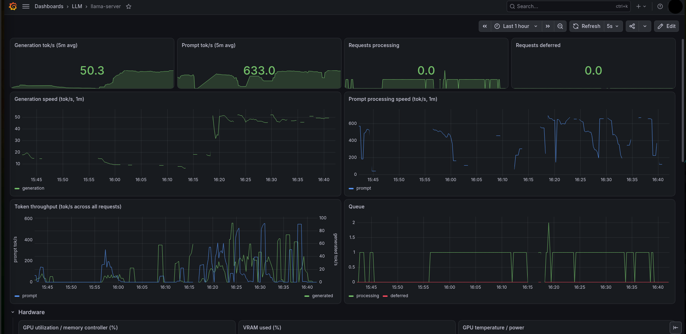
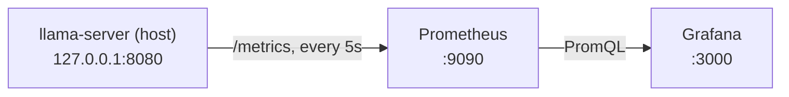
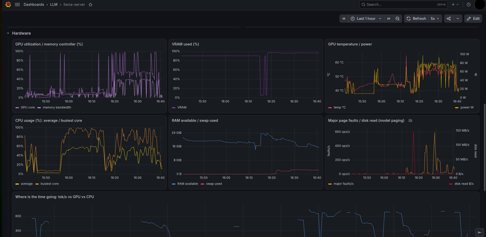
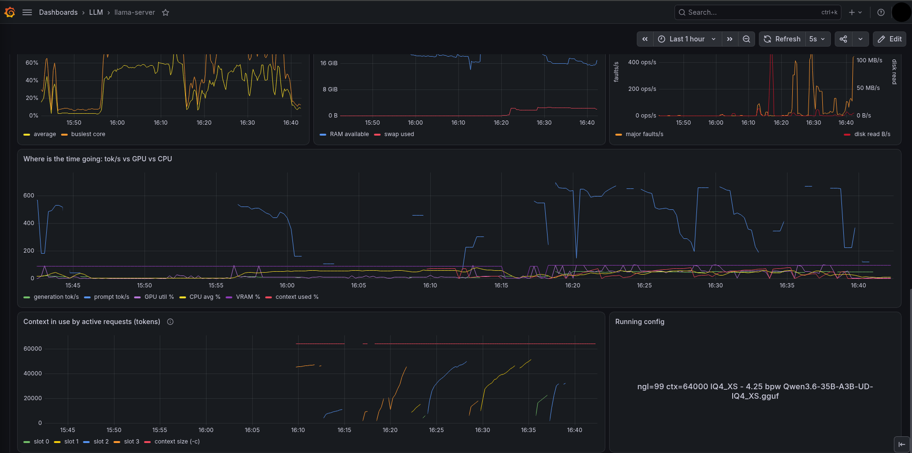
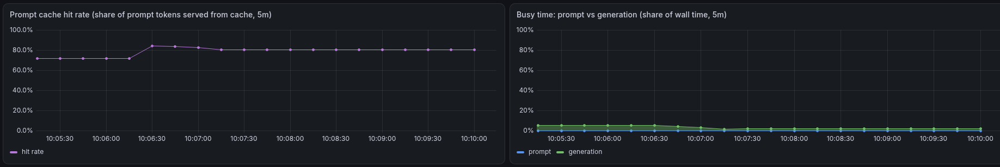

# ai-observability-stack

Prometheus + Grafana monitoring for a local [llama.cpp](https://github.com/ggml-org/llama.cpp) `llama-server`.

llama-server runs natively on the host (not in Docker). It exposes Prometheus metrics on `/metrics`, Prometheus scrapes them every 5s, and Grafana shows them on a pre-provisioned dashboard.





Prometheus, Grafana and the exporters use `network_mode: host` so they can reach llama-server on `127.0.0.1` without rebinding it. Everything listens on localhost only.

<details open>
<summary><h2>Layout</h2></summary>

```text
.
├── .env.example                               # paths for run.sh (copy to .env)
├── run.sh                                     # starts the stack, then llama-server
├── docker-compose.yml                         # Prometheus, Grafana, node/GPU/slots exporters
├── prometheus/
│   └── prometheus.yml                         # scrape config
├── slots-exporter/
│   └── exporter.py                            # /slots + /props -> Prometheus metrics (:9840)
└── grafana/
    ├── dashboards/
    │   └── llama-server.json                  # dashboard
    └── provisioning/
        ├── dashboards/dashboards.yml          # loads dashboards/ into folder "LLM"
        └── datasources/prometheus.yml         # Prometheus datasource
```

</details>

<details open>
<summary><h2>Prerequisites</h2></summary>

On the host:

- [llama.cpp](https://github.com/ggml-org/llama.cpp) built with CUDA (`build/bin/llama-server`), and a GGUF model
- Docker with the Compose plugin (`docker compose`)
- NVIDIA driver with `nvidia-smi` (no NVIDIA container toolkit needed, see [Host and GPU metrics](#host-and-gpu-metrics))
- `curl` for the checks below

Everything else runs from pinned Docker images, so nothing else needs installing:

| Component | Image | Port |
|---|---|---|
| Prometheus | `prom/prometheus:v3.15.0` | 9090 |
| Grafana | `grafana/grafana:13.2.2` | 3000 |
| node-exporter | `prom/node-exporter:v1.12.1` | 9100 |
| nvidia-gpu-exporter | `utkuozdemir/nvidia_gpu_exporter:1.3.1` | 9835 |
| slots-exporter | `python:3.13-slim` running `slots-exporter/exporter.py` (stdlib only, no pip packages) | 9840 |

</details>

<details open>
<summary><h2>Running</h2></summary>

Shortcut: copy `.env.example` to `.env`, set `LLAMA_CPP_DIR` and `MODEL_PATH`, then `./run.sh` does steps 1 and 2 (stack first, then llama-server in the foreground). Flags can be overridden per run, e.g. `N_CPU_MOE=9 ./run.sh` or `EXTRA_ARGS="-ctk q8_0 -ctv q8_0" ./run.sh`.

### 1. Start llama-server with `--metrics`

Without `--metrics`, `/metrics` returns 501 and Prometheus has nothing to scrape.

```bash
cd /path/to/llama.cpp
./build/bin/llama-server \
  -m ~/models/unsloth/qwen/Qwen3.6-35B-A3B-UD-IQ4_XS.gguf \
  -ngl 99 \
  --n-cpu-moe 10 \
  -c 64000 \
  --no-reasoning-preserve \
  --host 127.0.0.1 \
  --port 8080 \
  --metrics
```

`-ngl 99 --n-cpu-moe 10` keeps attention for all layers on the GPU and puts only the expert tensors of 10 layers on the CPU. On this machine (RTX 5060 Ti 16 GB, 35B-A3B MoE at IQ4_XS) that gave about 48 tok/s generation versus about 10 tok/s with `-ngl 30`, at similar VRAM (~0.5 GiB left free). If it runs out of VRAM, raise `--n-cpu-moe`.

This keeps its terminal busy. Run the next steps in a second terminal.

### 2. Start Prometheus and Grafana

```bash
sudo systemctl enable --now docker   # first time only
cd /path/to/ai-observability-stack
docker compose up -d
```

All five containers use `restart: unless-stopped`, so they come back after a reboot as long as Docker is enabled.

### 3. Open the dashboard

http://localhost:3000/d/llama-server/llama-server. Log in as `admin` with the value of `GRAFANA_ADMIN_PASSWORD` if set (default `admin`, which Grafana only applies on first start; change it in the UI afterwards).

The graphs fill in once the model serves requests.

</details>

<details open>
<summary><h2>Dashboard</h2></summary>

| Panel | Query |
|---|---|
| Generation tok/s (5m avg) | `rate(llamacpp:tokens_predicted_total[5m]) / rate(llamacpp:tokens_predicted_seconds_total[5m])` |
| Prompt tok/s (5m avg) | `rate(llamacpp:prompt_tokens_total[5m]) / rate(llamacpp:prompt_seconds_total[5m])` |
| Requests processing / deferred | `llamacpp:requests_processing`, `llamacpp:requests_deferred` |
| Generation / prompt speed (1m) | same ratios as above over `[1m]` |
| Token throughput | `rate(llamacpp:tokens_predicted_total[1m])`, `rate(llamacpp:prompt_tokens_total[1m])` (generation on the right axis) |
| Context in use by active requests | `llamacpp_slot_context_tokens`, `llamacpp_context_size_tokens` |
| Running config | `llamacpp_config_info` |
| Hardware row | GPU utilization, VRAM, temperature and power (`nvidia_smi_*`); CPU, RAM and swap (`node_cpu_*`, `node_memory_*`); page faults and disk reads, which show the model paging from disk (`node_vmstat_pgmajfault`, `node_disk_*`) |
| Where is the time going | tok/s overlaid with GPU util, CPU avg, VRAM % and `llamacpp_context_used_ratio` |
| Prompt cache hit rate (5m) | `rate(llamacpp:prompt_tokens_cached_total[5m]) / (rate(...cached_total[5m]) + rate(llamacpp:prompt_tokens_total[5m]))` |
| Busy time: prompt vs generation | `rate(llamacpp:prompt_seconds_total[5m])`, `rate(llamacpp:tokens_predicted_seconds_total[5m])`, stacked as share of wall time |

The speed panels use counter ratios rather than llama-server's `llamacpp:predicted_tokens_seconds` / `llamacpp:prompt_tokens_seconds` gauges. Those gauges reset each time `/metrics` is read, so at a 5s scrape interval they mostly read 0.

Grafana re-reads `grafana/dashboards/*.json` automatically, so edits to the file show up after a page refresh.

### Screenshots

Hardware row:



"Where is the time going" overlay, context in use per slot, and the running config:



Prompt cache hit rate and busy time split:



</details>

<details open>
<summary><h2>Checking it works</h2></summary>

```bash
curl -s -o /dev/null -w '%{http_code}\n' localhost:8080/metrics   # 200 (501 = missing --metrics, 503 = model loading)
curl -s localhost:9090/api/v1/targets | grep -o '"job":"[a-z-]*"\|"health":"[a-z]*"'
# expect four jobs (llama-server, node, nvidia-gpu, llama-slots), each followed by "health":"up"
docker compose ps
```

Send a test request to make the graphs move:

```bash
curl -s localhost:8080/v1/chat/completions -H 'Content-Type: application/json' \
  -d '{"messages":[{"role":"user","content":"Explain how a hash map works."}],"max_tokens":200}' > /dev/null
```

</details>

<details open>
<summary><h2>Host and GPU metrics</h2></summary>

`node-exporter` (:9100) and `nvidia-gpu-exporter` (:9835) run alongside Prometheus and feed the dashboard's Hardware row and the "Where is the time going" overlay. The GPU exporter doesn't use the NVIDIA container toolkit. It mounts the host's `nvidia-smi`, `libnvidia-ml.so.1` and `/dev/nvidia*` devices directly, so those paths in `docker-compose.yml` must match your driver install.

</details>

<details open>
<summary><h2>Slots exporter</h2></summary>

llama-server's `/metrics` only has speed and request counters. It doesn't say how full the context window is or which launch flags are in use. `slots-exporter/exporter.py` (stdlib Python, port 9840) fills the gap. On each scrape it reads llama-server's `/slots` (one slot is one parallel conversation) and `/props`, plus the server's command line from `/proc`, and republishes them as Prometheus metrics. This powers the context-in-use panels and the running-config panel, which labels graphs with the flags that produced them, so A/B tuning runs are easy to tell apart.

| Metric | Meaning |
|---|---|
| `llamacpp_slot_busy`, `llamacpp_slot_context_tokens`, `llamacpp_slot_prompt_cache_tokens`, ... | per-slot state of the active request |
| `llamacpp_context_used_tokens`, `llamacpp_context_used_ratio` | sum of active requests' tokens vs `-c` (idle cached context is not exposed by `/slots`) |
| `llamacpp_config_info{ngl,ctx,n_cpu_moe,quant,model,...}` | always 1; launch flags are read from the llama-server process in `/proc`, so labels follow restarts |
| `llamacpp_server_start_time_seconds` | process start time |

</details>

<details open>
<summary><h2>Possible next steps</h2></summary>

See [TODO.md](TODO.md).

</details>
