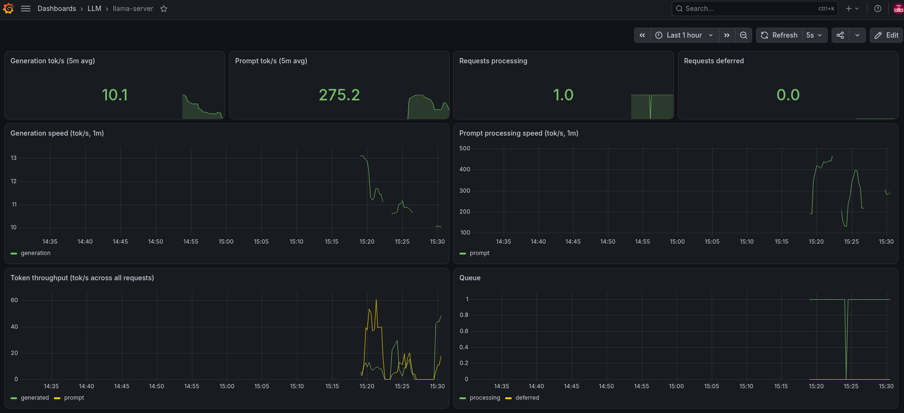

# ai-observability-stack

Prometheus + Grafana monitoring for a local [llama.cpp](https://github.com/ggml-org/llama.cpp) `llama-server`.

llama-server runs natively on the host (not in Docker). It exposes Prometheus metrics on `/metrics`, Prometheus scrapes them every 5s, and Grafana shows them on a pre-provisioned dashboard.



```text
┌────────────────────────┐   /metrics   ┌────────────┐   PromQL   ┌───────────┐
│ llama-server (host)    │ ───────────▶ │ Prometheus │ ─────────▶ │  Grafana  │
│ 127.0.0.1:8080         │   every 5s   │ :9090      │            │  :3000    │
└────────────────────────┘              └────────────┘            └───────────┘
```

Prometheus and Grafana use `network_mode: host` so they can reach llama-server on `127.0.0.1` without rebinding it. All three services listen on localhost only.

## Layout

```text
.
├── docker-compose.yml                         # Prometheus + Grafana
├── prometheus/
│   └── prometheus.yml                         # scrape config (127.0.0.1:8080)
└── grafana/
    ├── dashboards/
    │   └── llama-server.json                  # dashboard
    └── provisioning/
        ├── dashboards/dashboards.yml          # loads dashboards/ into folder "LLM"
        └── datasources/prometheus.yml         # Prometheus datasource
```

## Running

### 1. Start llama-server with `--metrics`

Without `--metrics`, `/metrics` returns 501 and Prometheus has nothing to scrape.

```bash
cd /path/to/llama.cpp
./build/bin/llama-server \
  -m ~/models/unsloth/qwen/Qwen3.6-35B-A3B-UD-IQ4_XS.gguf \
  -ngl 30 \
  -c 64000 \
  --no-reasoning-preserve \
  --host 127.0.0.1 \
  --port 8080 \
  --metrics
```

This keeps its terminal busy. Run the next steps in a second terminal.

### 2. Start Prometheus and Grafana

```bash
sudo systemctl enable --now docker   # first time only
cd /path/to/ai-observability-stack
docker compose up -d
```

Both containers use `restart: unless-stopped`, so they come back after a reboot as long as Docker is enabled.

### 3. Open the dashboard

http://localhost:3000/d/llama-server/llama-server. Log in as `admin` / `admin`, or the value of `GRAFANA_ADMIN_PASSWORD` if set.

The graphs fill in once the model serves requests.

## Dashboard

| Panel | Query |
|---|---|
| Generation tok/s (5m avg) | `rate(llamacpp:tokens_predicted_total[5m]) / rate(llamacpp:tokens_predicted_seconds_total[5m])` |
| Prompt tok/s (5m avg) | `rate(llamacpp:prompt_tokens_total[5m]) / rate(llamacpp:prompt_seconds_total[5m])` |
| Requests processing / deferred | `llamacpp:requests_processing`, `llamacpp:requests_deferred` |
| Generation / prompt speed (1m) | same ratios as above over `[1m]` |
| Token throughput | `rate(llamacpp:tokens_predicted_total[1m])`, `rate(llamacpp:prompt_tokens_total[1m])` |

The speed panels use counter ratios rather than llama-server's `llamacpp:predicted_tokens_seconds` / `llamacpp:prompt_tokens_seconds` gauges. Those gauges reset each time `/metrics` is read, so at a 5s scrape interval they mostly read 0.

Grafana re-reads `grafana/dashboards/*.json` automatically, so edits to the file show up after a page refresh.

## Checking it works

```bash
curl -s -o /dev/null -w '%{http_code}\n' localhost:8080/metrics   # 200 (501 = missing --metrics, 503 = model loading)
curl -s localhost:9090/api/v1/targets | grep -o '"health":"[a-z]*"' # "health":"up"
docker compose ps
```

Send a test request to make the graphs move:

```bash
curl -s localhost:8080/v1/chat/completions -H 'Content-Type: application/json' \
  -d '{"messages":[{"role":"user","content":"Explain how a hash map works."}],"max_tokens":200}' > /dev/null
```

## Host and GPU metrics

`node-exporter` (:9100) and `nvidia-gpu-exporter` (:9835) run alongside Prometheus and feed the dashboard's Hardware row and the "Where is the time going" overlay. The GPU exporter doesn't use the NVIDIA container toolkit. It mounts the host's `nvidia-smi`, `libnvidia-ml.so.1` and `/dev/nvidia*` devices directly, so those paths in `docker-compose.yml` must match your driver install.

## Possible next steps

See [TODO.md](TODO.md).
